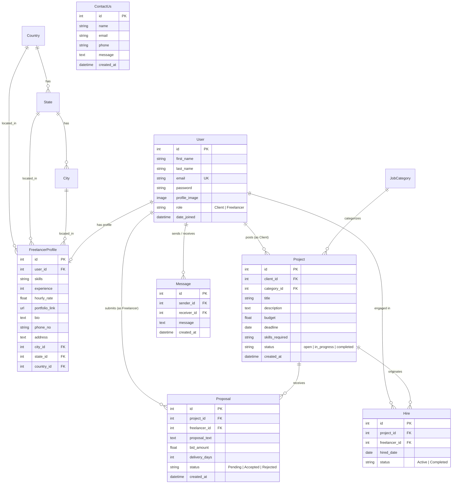

# 💼 HireHub - Freelance Marketplace & Job Portal

<p align="center">
  
</p>

<p align="center">
  <em>A powerful, modular freelancing marketplace platform connecting ambitious clients with skilled freelancers worldwide.</em>
</p>

<p align="center">
  <a href="https://www.python.org/"></a>
  <a href="https://www.djangoproject.com/"></a>
  <a href="https://django-jazzmin.readthedocs.io/"></a>
  <a href="https://www.sqlite.org/"></a>
  
  
</p>

<p align="center">
  <a href="https://vercel.com/new/clone?repository-url=https://github.com/jiya-08/Hire-Hub">
    
  </a>
</p>

---

## 📌 Table of Contents

- [🌟 Overview](#-overview)
- [✨ Key Features](#-key-features)
- [🛠️ Tech Stack](#️-tech-stack)
- [📊 Database Architecture & Models](#-database-architecture--models)
- [📁 Project Structure](#-project-structure)
- [🚀 Quick Start & Installation](#-quick-start--installation)
- [☁️ Deploying to Vercel](#️-deploying-to-vercel)
- [🎨 Admin Dashboard Showcase](#-admin-dashboard-showcase)
- [🗺️ Development Roadmap](#️-development-roadmap)
- [🤝 Contributing](#-contributing)
- [📄 License](#-license)
- [👤 Author](#-author)

---

## 🌟 Overview

**HireHub** is a Django-based freelancing and job hiring ecosystem designed to bridge the gap between clients looking to hire talent and freelancers offering specialized services. From project posting, proposal submissions, bidding, and contract finalization to direct messaging and contact inquiries, HireHub provides a robust foundation for modern recruitment workflows.

The project features a sleek, customized administration panel powered by **Django Jazzmin**, complete with responsive navigation, model-specific FontAwesome iconography, horizontal tab layouts, and theme switching (Light Flatly / Darkly).

---

## ✨ Key Features

- **👥 Multi-Role User Management:**
  - Dedicated roles for **Clients** and **Freelancers**.
  - Detailed freelancer profiles including hourly rates, portfolio links, bios, experience, and contact info.
  - Profile image upload integration via Pillow.

- **🌍 Geographical Cascading Structure:**
  - Normalized geographic mapping: **Country ➔ State ➔ City**.
  - Accurate location-based filtering for talent search.

- **💼 Job & Project Management:**
  - Categorized job postings (`JobCategory`).
  - Budget allocation, project deadlines, and skill requirement tags.
  - Project lifecycle tracking (`open`, `in_progress`, `completed`).

- **📝 Proposals & Bidding System:**
  - Freelancers can submit competitive proposals with bid amount and delivery timelines.
  - Status management (`Pending`, `Accepted`, `Rejected`).

- **🤝 Hires & Contract Tracking:**
  - Convert approved proposals directly into active hire contracts with automated timestamping.
  - Active and Completed contract states.

- **💬 Direct Messaging & Contact Support:**
  - Internal communication thread between users (`Sender` ➔ `Receiver`).
  - Public `ContactUs` inquiry capture and admin handling.

- **🎨 Modernized Jazzmin Admin Portal:**
  - Bootstrap 4 / AdminLTE responsive UI.
  - Integrated search models, custom sidebar icons, sticky top actions, and horizontal modal tabs.

---

## 🛠️ Tech Stack

| Component | Technology / Library | Description |
| :--- | :--- | :--- |
| **Framework** | [Django 6.0](https://www.djangoproject.com/) | High-level Python web framework |
| **Language** | [Python 3.10+](https://www.python.org/) | Core backend programming language |
| **Admin Theme** | [django-jazzmin 3.0](https://github.com/farridav/django-jazzmin) | Drop-in theme for Django admin |
| **Imaging** | [Pillow 12.3](https://python-pillow.org/) | User avatar and image processing |
| **Database** | [SQLite3](https://www.sqlite.org/) | Lightweight relational development database |
| **Static Handling** | Django StaticFiles & ASGI | Asynchronous server gateway & asset management |

---

## 📊 Database Architecture & Models



---

## 📁 Project Structure

```plaintext
HireHub/
├── HireHub/                      # Inner Django Project Root
│   ├── HireHub/                  # Project Configuration
│   │   ├── __init__.py
│   │   ├── asgi.py               # ASGI Configuration
│   │   ├── settings.py           # Project Settings & Jazzmin UI Tweaks
│   │   ├── urls.py               # Main URL Routing
│   │   └── wsgi.py               # WSGI Configuration
│   ├── static/                   # Static Assets (Images, Logos, CSS)
│   │   └── logo.png.png          # Brand Logo
│   ├── usersapp/                 # Core Marketplace App
│   │   ├── migrations/           # Database Migration History
│   │   ├── admin.py              # Custom ModelAdmin Registrations
│   │   ├── apps.py               # App Config
│   │   ├── models.py             # Relational Data Models
│   │   ├── urls.py               # App-level URL routes
│   │   └── views.py              # Controller & View handlers
│   ├── manage.py                 # Django Command-Line Utility
│   └── requirements.txt          # App dependencies
├── .env.example                  # Environment Variables Template
├── .gitignore                    # Git Ignored Files Configuration
├── requirements.txt              # Project dependencies
└── README.md                     # Documentation
```

---

## 🚀 Quick Start & Installation

Follow these steps to set up the project locally:

### 1. Prerequisites
- **Python 3.10** or higher installed. Check with:
  ```bash
  python --version
  ```
- **Git** installed on your system.

### 2. Clone the Repository
```bash
git clone https://github.com/jiya-08/Hire-Hub.git
cd Hire-Hub
```

### 3. Create and Activate a Virtual Environment
- **Windows (PowerShell):**
  ```powershell
  python -m venv .venv
  .venv\Scripts\Activate.ps1
  ```
- **Windows (Command Prompt):**
  ```cmd
  python -m venv .venv
  .venv\Scripts\activate.bat
  ```
- **macOS / Linux:**
  ```bash
  python3 -m venv .venv
  source .venv/bin/activate
  ```

### 4. Install Dependencies
```bash
pip install -r requirements.txt
```

### 5. Apply Database Migrations
```bash
cd HireHub
python manage.py makemigrations
python manage.py migrate
```

### 6. Create an Admin Superuser
```bash
python manage.py createsuperuser
```
Follow the prompts to enter a username, email, and password.

### 7. Run the Development Server
```bash
python manage.py runserver
```

Open your browser and navigate to:
- 🌐 **Home Page:** [http://127.0.0.1:8000/](http://127.0.0.1:8000/)
- 🛡️ **Admin Dashboard:** [http://127.0.0.1:8000/admin/](http://127.0.0.1:8000/admin/)

---

## ☁️ Deploying to Vercel

HireHub is fully configured for seamless deployment on [Vercel](https://vercel.com/) via `@vercel/python` serverless functions and `@vercel/static-build`:

1. **Import Repository:**
   - Log into your [Vercel Dashboard](https://vercel.com/).
   - Click **Add New... ➔ Project**.
   - Select and import **`jiya-08/Hire-Hub`**.
2. **Configure Environment Variables:**
   Under **Environment Variables**, you can define:
   - `SECRET_KEY`: A secure production secret key.
   - `DATABASE_URL`: Connection URL for your external database (e.g., PostgreSQL on [Neon](https://neon.tech/), [Supabase](https://supabase.com/), or Railway).
   - `DEBUG`: `False` (or `True` during testing).
3. **Deploy:**
   - Click **Deploy**. Vercel runs `build_files.sh` to install dependencies and collect all Jazzmin static assets automatically.
   - Your site will be live at `https://<your-project>.vercel.app/`!

---

## 🎨 Admin Dashboard Showcase

HireHub comes out of the box with **Jazzmin** theme configuration:

- **Theme:** `flatly` with dark mode support (`darkly`).
- **Icons:**
  - 👤 **Users:** `fas fa-user`
  - 🌐 **Countries:** `fas fa-globe`
  - 🗺️ **States:** `fas fa-map`
  - 🏙️ **Cities:** `fas fa-city`
  - 👔 **Freelancer Profiles:** `fas fa-user-tie`
  - 📋 **Job Categories:** `fas fa-list`
  - 💼 **Projects:** `fas fa-briefcase`
  - ✍️ **Proposals:** `fas fa-file-signature`
  - 🤝 **Hires:** `fas fa-handshake`
  - ✉️ **Messages:** `fas fa-envelope`
  - 📞 **Contact Us:** `fas fa-phone`
- **UI Tweaks:** Horizontal form tabs, live UI customizer, sticky navigation bar, and responsive sidebar navigation.

---

## 🗺️ Development Roadmap

- [ ] **RESTful API:** Build endpoints using Django REST Framework (DRF) for mobile/SPA clients.
- [ ] **Frontend Integration:** Modern UI built with TailwindCSS / React.js.
- [ ] **Authentication:** Secure JWT authentication and social OAuth (Google, GitHub, LinkedIn).
- [ ] **Real-Time Chat:** WebSocket-based direct messaging using Django Channels.
- [ ] **Payment Escrow:** Integration with Stripe or PayPal for milestone payments.
- [ ] **Review & Rating System:** Star ratings and reviews for completed freelancer jobs.

---

## 🤝 Contributing

Contributions make the open-source community an amazing place to learn, inspire, and create! Any contributions you make are **greatly appreciated**.

1. Fork the Project
2. Create your Feature Branch (`git checkout -b feature/AmazingFeature`)
3. Commit your Changes (`git commit -m 'Add some AmazingFeature'`)
4. Push to the Branch (`git push origin feature/AmazingFeature`)
5. Open a Pull Request

---

## 📄 License

Distributed under the **MIT License**. See `LICENSE` for more information.

---

## 👤 Author

Developed with ❤️ by **[Jiya Joshi](https://github.com/joshijiya)**

*If you found this project helpful, please consider giving it a ⭐ on GitHub!*
